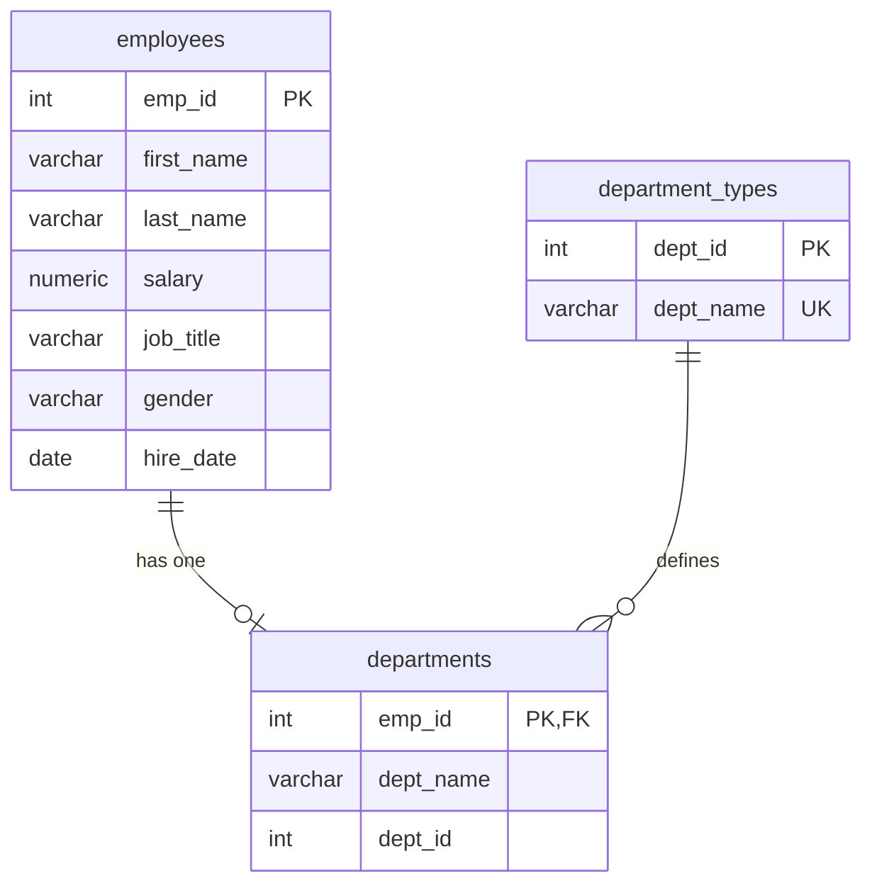

# Database_Module_Week2
Database_Module_Week2 Assigments By Waseem Isaac

# SQL file with 12 queries for the Sakila rental database
# 👥 Employee & Department Manager

### PostgreSQL + Python (PyQt6) — Database Module, Week 2


A modern dark-themed desktop application for managing employees and departments stored in a PostgreSQL database. It supports full **Create / Read / Update / Delete** operations, department assignment, searchable and paginated tables, and a built-in **SQL editor** for running your own queries and viewing the results in a table.

The repository also contains the Week 2 assignment scripts: a Python script that builds the sample database and runs 10 report queries, and a SQL file with 12 queries for the Sakila rental database.

---

## 📑 Table of Contents

- [Features](#-features)
- [Project Structure](#-project-structure)
- [Database Schema](#-database-schema)
- [Getting Started](#-getting-started)
- [Using the Application](#-using-the-application)
- [Quick Queries](#-quick-queries)
- [Assignment Scripts](#-assignment-scripts)
- [Configuration & Security](#-configuration--security)
- [Troubleshooting](#-troubleshooting)
- [Author](#-author)

---

## ✨ Features

**Connection**
- 🔌 Connection window shown first; the main window opens only after a successful connection test
- 💾 Optional "remember password" — otherwise the password is never written to disk

**Employees**
- ➕ Add, ✏️ update and 🗑️ delete employees (deleting also removes their department assignment)
- 🎲 One-click suggestion of the next free employee ID
- 🛡️ Duplicate protection: blocks an existing ID and asks for confirmation when the same name already exists
- 💰 Salary spinner, 📅 calendar date picker, and a job-title dropdown built from existing titles

**Departments**
- 🏢 Assign a department to an employee; the employee's current department is shown before you assign
- 🔁 If the employee already has a department, the app offers to **change** it instead of failing
- 🗂️ Manage the list of department types (ID + name) from the UI — nothing is hard-coded after first run
- 🔒 A department type that is still in use cannot be deleted

**Tables**
- 🔍 Live search across all rows
- 📄 Pagination: 25 / 50 / 100 / 250 / 500 / All rows per page, numbered page buttons, row counter
- 📊 Dashboard cards: total employees, average salary, department types, assigned employees

**SQL Editor**
- 🧮 Syntax-highlighted editor — run with **Ctrl + Enter** or **F5**
- 📌 Dropdown with 10 ready-made queries and a history of your last 20 queries
- 🔒 **Read-only mode** on by default; confirmation prompt before any query that changes data
- 📤 Export results to CSV (up to 100,000 rows, shown with pagination)

---

## 📁 Project Structure

```
.
├── PostgreSQLusingPython_-UI_-waseem.py            # Desktop application (PyQt6 + psycopg2)
├── Assigment-2_Database_Module_Week2_-Waseem.py    # Creates tables, loads sample data, runs 10 queries
├── Assigment-1_Database_Module_Week2_-Waseem.sql   # 12 queries for the Sakila rental database
├── db_settings.json                                # Created on first connect (do not commit)
└── README.md
```

---

## 🗄️ Database Schema

The application works with the `emp_db` database and three tables. `employees` and `departments` are created by the assignment script; `department_types` is created automatically by the application on first run.



- Each employee can belong to **one** department (`departments.emp_id` is the primary key).
- `ON DELETE CASCADE` removes an employee's assignment when the employee is deleted.
- Default department types (seeded once): Administrative `11`, Technology `12`, Operations `13`, Marketing `14`, Sales `15`, HR `16`, Finance `17`.

---

## 🚀 Getting Started

### Prerequisites

- Python **3.9** or newer
- PostgreSQL, running locally or reachable over the network (tested with PostgreSQL 16)
- A database named `emp_db` (or any name you enter in the connection window)

### 1. Install dependencies

```bash
python -m pip install PyQt6 psycopg2
```

### 2. Create the database

```sql
CREATE DATABASE emp_db;
```

### 3. Create the tables and sample data

Open `Assigment-2_Database_Module_Week2_-Waseem.py`, enter your PostgreSQL password in `DB_CONFIG`, then run:

```bash
python Assigment-2_Database_Module_Week2_-Waseem.py
```

> ⚠️ This script **drops and recreates** the `employees` and `departments` tables. Do not run it against a database that holds data you want to keep.

### 4. Start the application

```bash
python PostgreSQLusingPython_-UI_-waseem.py
```

Enter your connection details in the connection window and click **🔌 Connect**.

---

## 🖥️ Using the Application

| Tab | What you can do |
|---|---|
| **👨‍💼 Employees** | Fill the form and click **Add**. Click a row to load it into the form, then **Update** or **Delete**. **Clear** resets the form. |
| **🏢 Assign Departments** | Pick an employee and a department, then **Assign Department**. Select a row and click **Remove Selected** to remove an assignment. |
| **🗂️ Department Types** | Add new departments (ID + name) or delete unused ones. Changes appear immediately in the assignment list. |
| **🧮 SQL Query** | Write or pick a query, press **Run Query** (or `Ctrl+Enter` / `F5`), and view the result below. Use **Export CSV** to save it. |

**Keyboard shortcut:** `Ctrl + Enter` or `F5` runs the current query.

**Read-only mode:** while the 🔒 checkbox is ticked, only queries that read data will run. Untick it to run `INSERT`, `UPDATE` or `DELETE`; the app asks for confirmation first and refreshes all tabs afterwards.

---

## 📌 Quick Queries

These queries are available in the **SQL Query** tab dropdown:

| # | Query |
|---|---|
| 1 | Employees paid more than Rodney Weaver |
| 2 | Average, minimum and maximum salaries |
| 3 | Employees whose salary is more than 8700 |
| 4 | Employees in the Operations department |
| 5 | Employees in the Technology department |
| 6 | Average salary of female employees |
| 7 | Average salary of each department |
| 8 | Oldest and newest employees |
| 9 | Hiring date and department of the highest paid employee |
| 10 | Hiring date and department of the lowest paid employee |

> **Note:** with the sample data, salaries range from 55,000 to 110,000, so query 3 (threshold 8,700) returns every employee. Change the threshold in the SQL editor to see a filtered result.

To add or change queries, edit the `QUERY_TEMPLATES` dictionary near the top of the application file.

---

## 📝 Assignment Scripts

### `Assigment-1_Database_Module_Week2_-Waseem.py`
Creates the `employees` and `departments` tables, inserts 10 sample employees with their departments, and prints the results of 10 report queries (salary comparisons, averages per department and gender, oldest/newest employee, highest/lowest paid employee).

### `Assigment-1_Database_Module_Week2_-Waseem.sql`
12 queries for the **Sakila** rental database (PostgreSQL port), covering filtering with `IN`, sorting with `NULLS LAST`, `JOIN`s across `film`, `inventory`, `rental` and `payment`, `NULL` checks, and aggregate functions (`COUNT`, `SUM`, `MAX`, `MIN`). Load the Sakila sample database first, then run the file in `psql`, pgAdmin or DBeaver.

---

## 🔐 Configuration & Security

- Connection details are saved in `db_settings.json` next to the application file. If **Remember password** is unticked, the password is not saved.
- You can set the `DB_PASSWORD` environment variable to provide the password without storing it in a file; it overrides the saved value.
- **Never commit passwords.** Add `db_settings.json` to `.gitignore`:

  ```
  db_settings.json

  ```
- `Assigment-2_Database_Module_Week2_-Waseem.py` keeps its password in the `DB_CONFIG` dictionary. Replace it with a placeholder (or read it from an environment variable) before sharing or publishing the code.
- All data-changing statements in the application use parameterized queries. The SQL editor runs exactly what you type, so keep **Read-only mode** on unless you intend to change data.

---

## 🛠️ Troubleshooting

| Problem | Solution |
|---|---|
| **Cannot connect** | Check that PostgreSQL is running, and verify host, port (default `5432`), database name, user and password. The connection window shows the exact error. |
| **"This record already exists (duplicate key)"** | The ID is already used. For employees, click 🎲 to get the next free ID. Each employee can have only one department, so the app offers to change the existing one. |
| **"Relation does not exist"** | The tables are missing. Run the assignment script (step 3) against the same database. |
| **Cannot delete a department type** | It is still assigned to employees. Remove or change those assignments first. |

---

## 👤 Author

**Waseem Isaac**
